<p align="center">
  
</p>

<h1 align="center">Peck</h1>

<p align="center">一个解决 Mac 未签名软件打开已损坏的小工具，帮你啄掉障碍，让软件重新自由飞翔</p>

<p align="center">
  <a href="https://github.com/eryajf"></a>
  <a href="https://github.com/eryajf/Peck"></a>
  <a href="https://github.com/eryajf/Peck"></a>
  <a href="https://github.com/eryajf/Peck/stargazers"></a>
  <a href="https://github.com/eryajf/Peck/blob/main/LICENSE"></a>
  <a href="https://cnb.cool/znb/Peck"></a>
  <a href="https://linux.do"></a>
</p>

<p align="center">
  
</p>

Peck 基于 [Viva](https://github.com/vivaui/viva) 原生 UI 框架和 Go 构建，不使用 WebView 或前端框架。它帮助你检查一个 macOS 应用的来源、签名、隔离标记和包内结构，在你明确确认后，移除下载隔离标记、按需添加本地 ad-hoc 签名，并尝试打开应用。

Peck 不会替你判断一个应用是否安全，也不会修改系统级 Gatekeeper 设置。每一次处理都针对你选择的单个应用，并在执行前展示检查结果。


## 主要功能

- 拖入或选择 macOS 应用，查看来源、签名和隔离状态。
- 确认后移除隔离标记，或按需添加本地 ad-hoc 签名，并查看处理结果。
- 常驻菜单栏，支持中英文界面、主题切换和从项目页面唤起。

## 安装

从 [GitHub Releases](https://github.com/eryajf/Peck/releases) 下载适合你的 Mac 的版本并安装。

## 使用

1. 启动 Peck，点击菜单栏里的啄木鸟图标打开面板。
2. 将需要处理的 `.app` 拖入面板，或点击“选择应用”。
3. 查看应用路径、签名状态、隔离标记和系统检查结果，确认它确实来自你信任的来源。
4. 选择要执行的处理项。移除隔离标记和本地 ad-hoc 签名是两个独立动作，未选择的动作不会执行。
5. 点击“确认并处理”，等待结果。处理完成后，只有点击“打开应用”才会尝试启动目标应用。

处理任务在后台执行；隐藏面板不会取消任务。“停止”只会取消尚未执行的后续步骤，并保留已经完成的结果。应用图标、名称和版本来自本机实际的 App bundle，不会因为深链接中的项目名称而自动信任某个文件。

### 从项目页面唤起 Peck

开源项目可以使用下面的链接把用户带入 Peck 的准备流程：

```text
peck://prepare?v=1&project=Example%20App&bundle_id=org.example.app
```

`project` 用于显示项目上下文，`bundle_id` 和可选的 `release` 只用于匹配本机候选应用。深链接不能传入本地路径、命令、凭据或自动执行权限；用户仍需核对真实路径并点击确认。

### 开源项目一键打开

下面的项目清单来自 [`data/unsigned-projects.json`](data/unsigned-projects.json)。如果你下载了其中项目的未签名版本，或系统因为隔离标记阻止了打开，可以点击项目右侧图标，把项目上下文带入 Peck 的准备流程。新增项目时，只需提交 JSON 变更；合并后 GitHub Actions 会自动更新这张表，官网也可以直接复用这份数据。

提交新项目时，请在 `projects` 中增加 `name`、`description`、`homepage`、`bundle_id` 和 `icon`。首页和图标必须使用 HTTPS，`bundle_id` 必须与 App 的 `CFBundleIdentifier` 完全一致。

`release` 是可选的版本匹配提示，默认不要填写。省略它时，Peck 会匹配相同 Bundle ID 的当前版本，项目发布新版本后不需要更新这份清单；只有需要精确处理某个版本，或需要在本机存在多个同 Bundle ID 应用时缩小匹配范围，才填写 `release`。它可以匹配 App 的 `CFBundleShortVersionString` 或 `CFBundleVersion`。

<!-- BEGIN UNSIGNED PROJECTS -->

| 项目 | 说明 | 一键打开 |
| --- | --- | --- |
| [IINA](https://github.com/iina/iina) | macOS 原生视频播放器 | [](peck://prepare?v=1&project=IINA&bundle_id=com.colliderli.iina&homepage=https%3A%2F%2Fgithub.com%2Fiina%2Fiina "使用 Peck 打开 IINA") |
| [Rectangle](https://github.com/rxhanson/Rectangle) | macOS 窗口管理工具 | [](peck://prepare?v=1&project=Rectangle&bundle_id=com.knollsoft.Rectangle&homepage=https%3A%2F%2Fgithub.com%2Frxhanson%2FRectangle "使用 Peck 打开 Rectangle") |
| [AltTab](https://github.com/lwouis/alt-tab-macos) | macOS 窗口切换器 | [](peck://prepare?v=1&project=AltTab&bundle_id=com.lwouis.alt-tab-macos&homepage=https%3A%2F%2Fgithub.com%2Flwouis%2Falt-tab-macos "使用 Peck 打开 AltTab") |
| [Stats](https://github.com/exelban/stats) | macOS 系统状态监视器 | [](peck://prepare?v=1&project=Stats&bundle_id=eu.exelban.Stats&homepage=https%3A%2F%2Fgithub.com%2Fexelban%2Fstats "使用 Peck 打开 Stats") |
| [Mos](https://github.com/Caldis/Mos) | 平滑滚动和鼠标工具 | [](peck://prepare?v=1&project=Mos&bundle_id=com.caldis.Mos&homepage=https%3A%2F%2Fgithub.com%2FCaldis%2FMos "使用 Peck 打开 Mos") |
| [Keka](https://github.com/aonez/Keka) | macOS 文件压缩与解压工具 | [](peck://prepare?v=1&project=Keka&bundle_id=com.aone.keka&homepage=https%3A%2F%2Fgithub.com%2Faonez%2FKeka "使用 Peck 打开 Keka") |
| [CotEditor](https://github.com/coteditor/CotEditor) | 轻量的 macOS 文本编辑器 | [](peck://prepare?v=1&project=CotEditor&bundle_id=com.coteditor.CotEditor&homepage=https%3A%2F%2Fgithub.com%2Fcoteditor%2FCotEditor "使用 Peck 打开 CotEditor") |
| [KeepingYouAwake](https://github.com/newmarcel/KeepingYouAwake) | 阻止 Mac 自动睡眠的小工具 | [](peck://prepare?v=1&project=KeepingYouAwake&bundle_id=com.keepingu.KeepingYouAwake&homepage=https%3A%2F%2Fgithub.com%2Fnewmarcel%2FKeepingYouAwake "使用 Peck 打开 KeepingYouAwake") |
| [Motrix](https://github.com/agalwood/Motrix) | 全能下载管理器 | [](peck://prepare?v=1&project=Motrix&bundle_id=net.agalwood.Motrix&homepage=https%3A%2F%2Fgithub.com%2Fagalwood%2FMotrix "使用 Peck 打开 Motrix") |

<!-- END UNSIGNED PROJECTS -->

贡献者可以在本地校验清单并生成 README：

```sh
node scripts/render-unsigned-projects.mjs --validate
node scripts/render-unsigned-projects.mjs --write
```

## 开发与构建

需要 macOS 14 或更高版本，以及 Go 1.27.3 或更高版本。项目直接使用官方 `github.com/vivaui/viva` 模块：

```sh
go mod download
go run .
```

构建未签名的本地 App 和 ZIP：

```sh
make package
```

项目要求 Go 1.27.3 或更高版本。如果本机设置了 `GOTOOLCHAIN=local`，请先安装对应版本的 Go；否则 Go 无法自动切换到 `go.mod` 声明的工具链。

## 捐赠与支持

如果 Peck 对你有帮助，欢迎通过[捐赠支持页面](https://wiki.eryajf.net/reward/)请作者喝杯咖啡。你的反馈、问题报告和使用体验同样有帮助，欢迎在 [GitHub Issues](https://github.com/eryajf/Peck/issues) 中提出。

## 许可证

Peck 使用 [Apache License 2.0](LICENSE) 发布。
