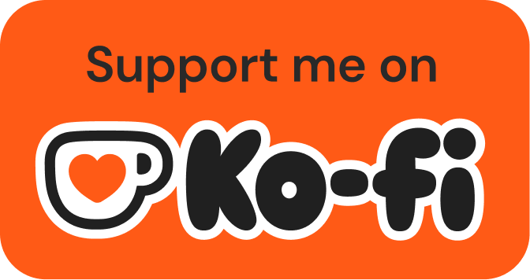

<p align="center">
  
</p>

<h1 align="center">Peck</h1>

<p align="center"><a href="../README.md">中文</a> | English</p>

<p align="center">A small macOS utility that helps open unsigned apps reported as damaged.</p>

<p align="center">
  <a href="https://github.com/eryajf"></a>
  <a href="https://github.com/eryajf/Peck"></a>
  <a href="https://github.com/eryajf/Peck"></a>
  <a href="https://github.com/eryajf/Peck/stargazers"></a>
  <a href="https://github.com/eryajf/Peck/blob/main/LICENSE"></a>
  <a href="https://cnb.cool/znb/Peck"></a>
  <a href="https://linux.do"></a>
</p>

<p align="center">
  
</p>

Peck is built with Go and the native [Viva](https://github.com/vivaui/viva) UI framework, without a WebView or frontend framework. It helps you inspect a macOS app's origin, signature, quarantine attributes, and bundle structure. With your explicit confirmation, it can remove download quarantine attributes, add a local ad-hoc signature when needed, and attempt to open the app.

Peck does not determine whether an app is safe or change system-wide Gatekeeper settings. Each operation targets a single app you select and presents the inspection results before proceeding.

## Features

- Drag in or select a macOS app to inspect its origin, signature, and quarantine status.
- Remove quarantine attributes or add a local ad-hoc signature after confirmation, and review the results.
- Use Peck from the menu bar, with Chinese and English interfaces, theme switching, and links from project pages.

## Demo

https://github.com/user-attachments/assets/ac012996-fb92-4fad-b2c0-20e953c2e738

## Installation

Download and install the version for your Mac from [GitHub Releases](https://github.com/eryajf/Peck/releases).

## Usage

1. Launch Peck and click the woodpecker icon in the menu bar to open the panel.
2. Drag the `.app` you want to process into the panel, or click “Choose app…”.
3. Review the app path, signature status, quarantine attributes, and system check results, and confirm that it comes from a source you trust.
4. Select the actions to perform. Removing quarantine attributes and adding a local ad-hoc signature are independent actions; unselected actions will not run.
5. Click “Confirm and process” and wait for the results. After processing, Peck only attempts to launch the target app when you click “Open app”.

Processing runs in the background; hiding the panel does not cancel it. “Stop” cancels only subsequent steps that have not yet run and preserves completed results. The app icon, name, and version come from the actual local app bundle; a project name in a deep link does not automatically make a file trusted.

### Launch Peck from a project page

Open-source projects can use the following link to bring users into Peck's preparation flow:

```text
peck://prepare?v=1&project=Example%20App&bundle_id=org.example.app
```

`project` displays the project context; `bundle_id` and the optional `release` are used only to match candidate apps on the local machine. Deep links cannot provide local paths, commands, credentials, or permission to run actions automatically. Users must still verify the actual path and click to confirm.

## Website

The website source is in [`website/`](../website/), and the project directory reads [`data/project-links.json`](../data/project-links.json) at build time. See the [website documentation](../website/README.md) for local development and automatic server deployment.

## Development and build

macOS 14 or later and Go 1.27.3 or later are required. The project uses the official `github.com/vivaui/viva` module directly:

```sh
go mod download
go run .
```

Build an unsigned local app and ZIP:

```sh
make package
```

If `GOTOOLCHAIN=local` is set, install the required Go version first; otherwise Go cannot automatically switch to the toolchain specified in `go.mod`.

## ☕ Sponsor and support

If you find this software useful and would like to support its continued development, you can contribute using either option below:

| Ko-fi *(outside China)* | | WeChat tip *(China)* |
| --- | --- | --- |
| [](https://ko-fi.com/eryajf) | or |  |

Feedback, bug reports, and your experience using Peck are also welcome in [GitHub Issues](https://github.com/eryajf/Peck/issues).

## License

Peck is released under the [Apache License 2.0](../LICENSE).
